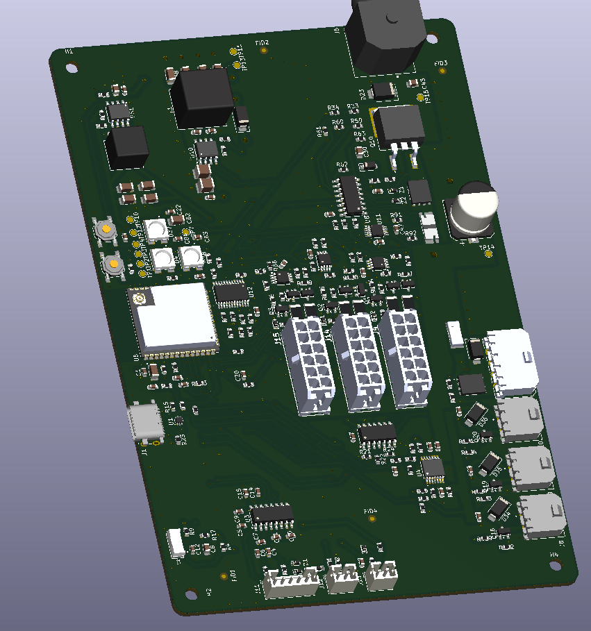

<div align="center">

# GrowHub - Vertical Garden

<p>
  
  
</p>

### _A highly efficient vertical plant growing garden with AI controlls for user-free handling experience._ 
  
</div>

---

# Overview

***GrowHub - Vertical Garden***

A sophisticated way of growing whatever kind of plant (only legal ones :}) from your living room, balcony, even your bedroom or wherever you want!

The idea of the project is to have a care-free environment where the user only monitors his plants from the website and we the developers are resposnible for making everything functional for healthy and low-cost plant growing.

It is a modular garden capable of supplying 1-3 floors of growing area split between 8 tiles per floor!!!

With a good team we managed to split the 4 main segments of this project accordingly which are: PCB and electrical construction, mechanical functioning of the project, server control, User-friendly and work-free experience for the customers.

---

# Motivation

In todays world a lot more people are living in flats and with the constant inflation plus the enforcment of consuming lab products a lot of people are getting restrained of consuming real, healthy and natural food.

The soil is constantly polluted due to new construction working and the constant droughts are limiting the farmers to produce enough single-ingredient food for the families in the metropolitan cities.

With those issues on mind me and my friend have come up with an idea to revolutionize the way people are getting natural ingreidents in their households.

The main goals that we want to achieve are the following:

- User-friendly and work-free experience for anyone having this product
- Highly efficiency for growing plants
- Healthy environment for both the plants and users

A lot of working skills are required for this project to succeed so i hope you understand our issues with shipping functional projects in Week 1.

---

# BOM

*Some modules are dependant based on the amount of floors accounted in the project (1-3)

_Everything is calculated for the highest amount of floors - 3_

_M = main board (×1) · F = floor board (×3) · Qty = M + 3 × F. Capacitors with no voltage listed sit on ≤ 5 V nets. Resistors are 1 % thick film, 0603 = 0.1 W, unless noted. DNP footprints and test pads are not listed._

| Designator | Function | Part | Package | Qty (3 floors) | Price (USD) | Link |
|---|---|---|---|---:|---|---|
| M: U6 | MCU module, Wi-Fi/BLE (16 MB flash, 8 MB PSRAM, U.FL antenna) | ESP32-S3-WROOM-1U-N16R8 | SMD module | 1 | $6.90 | [Mouser](https://www.mouser.com/en/ProductDetail/Espressif-Systems/ESP32-S3-WROOM-1U-N16R8?qs=Li%252BoUPsLEns6V0Pr5KRJtw%3D%3D) |
| M: U1 | USB ESD protection | USBLC6-2P6 | SOT-666 | 1 | $0.69 | [Mouser](https://www.mouser.com/en/ProductDetail/STMicroelectronics/USBLC6-2P6?qs=6ARB0lp6jlViGcbUSvj1Mw%3D%3D) |
| M: U2 | Ambient light sensor | VEML7700-TT | SMD, 4-pin | 1 | $1.35 | [Mouser](https://www.mouser.com/en/ProductDetail/Vishay-Semiconductors/VEML7700-TT?qs=BcfjnG7NVaXdL6DJFdWbdw%3D%3D) |
| M: U3 | Load-cell ADC | NAU7802SGI | SOIC-16 | 1 | $1.87 | [Mouser](https://www.mouser.com/en/ProductDetail/Nuvoton/NAU7802SGI?qs=A6eO%252BMLsxmSrxisJRahwRQ%3D%3D) |
| M: U4 | Valve rail switch | TPS27S100BPWPR | HTSSOP-14 | 1 | $1.87 | [Mouser](https://www.mouser.com/en/ProductDetail/Texas-Instruments/TPS27S100BPWPR?qs=0lQeLiL1qyaF4011Zes0Yg%3D%3D) |
| M: U5, U7, U9 | Floor-cable I²C buffers | PCA9600DPZ | TSSOP-8 | 3 | $21.00 | [Mouser](https://www.mouser.com/en/ProductDetail/NXP-Semiconductors/PCA9600DPZ?qs=Li%252BoUPsLEnu5vr2lXlgE1A%3D%3D) |
| M: U8 | Surge stopper | LTC4364IS-2#PBF | SOIC-16 | 1 | $14.82 | [Mouser](https://www.mouser.com/en/ProductDetail/Analog-Devices/LTC4364IS-2PBF?qs=hVkxg5c3xu9riE%252B4zWkG8g%3D%3D) |
| M: U10 | Buck, 24 V → 5 V | LMR33630ADDA | HSOP-8 (exposed pad) | 1 | $3.67 | [Mouser](https://www.mouser.com/en/ProductDetail/Texas-Instruments/LMR33630ADDA?qs=r5DSvlrkXmL3yj62Sna%2FpQ%3D%3D) |
| M: U11 | Input current / power monitor | INA226AIDGSR | VSSOP-10 | 1 | $2.95 | [Mouser](https://www.mouser.com/en/ProductDetail/Texas-Instruments/INA226AIDGSR?qs=tQG3bEuiOZD4quG3egR36g%3D%3D) |
| M: U12 | Floor bus switch (I²C mux) | TCA9548APWR | TSSOP-24 | 1 | $1.65 | [Mouser](https://www.mouser.com/en/ProductDetail/Texas-Instruments/TCA9548APWR?qs=sGAEpiMZZMutXGli8Ay4kHAf4%2FN1WW693xDAZd3LyqA%3D) |
| F: U13 | Temperature & humidity |  SHT40I-AD1F-R2 | DFN-4, 1.5 × 1.5 mm | 3 | $9.18 | [Mouser](https://www.mouser.com/en/ProductDetail/Sensirion/SHT40I-AD1F-R2?qs=rQFj71Wb1eVYLTRlLwJKVQ%3D%3D) |
| F: U14, U17 | 3.3 V LDOs: logic (U17), switched sensor rail (U14) | TPS7A2033PDBVR | SOT-23-5 | 6 |  |  |
| F: U16 | Tray-electrode ADC | ADS1115IDGSR | VSSOP-10 | 3 |  |  |
| F: U18 | Floor ID (1-Wire EEPROM) | DS28E07Q+T | TDFN-6, 3 × 3 mm | 3 |  |  |
| F: U19 | PWM: 4 LED channels | PCA9685BS,118 | HVQFN-28, 6 × 6 mm | 3 |  |  |
| F: U20 | Floor-end cable buffer | P82B96D | SOIC-8 | 3 |  |  |
| M: C11 | Load-cell ADC | 330 pF C0G | 0603 | 1 | $0.20 | [Mouser](https://www.mouser.com/en/ProductDetail/Walsin/0603B331K100CT?qs=sGAEpiMZZMsh%252B1woXyUXj9Vc%2FsqQGnyV%2FOvNY0Ao%252BFA%3D) |
| M: C19 | Valve current-monitor filter | 1 nF | 0603 | 1 | $0.19 | [Mouser](https://www.mouser.com/en/ProductDetail/KYOCERA-AVX/06031F102K4T2A?qs=%252BdQmOuGyFcFZxL9GWikwcQ%3D%3D) |
| M: C24 | Valve-switch input | 4.7 nF X7R 50 V | 0603 | 1 |  |  |
| M: C4, C6, C16, C18, C20, C57<br>F: C56, C64 | ADC / input filters | 10 nF X7R | 0603 | 12 |  | [Mouser](https://www.mouser.com/en/ProductDetail/KEMET/C0603F103K8RACTU?qs=sGAEpiMZZMukHu%252BjC5l7YXqC3L5J1PSDOxyZlqyYeaQ%3D) |
| M: C25 | Valve rail output | 22 nF X7R 50 V | 0603 | 1 |  |  |
| M: C13 | IO0 boot RC | 47 nF X7R | 0603 | 1 |  | [Mouser](https://www.mouser.com/en/ProductDetail/KEMET/C0603J473K8RAC7411?qs=sGAEpiMZZMukHu%252BjC5l7YXqC3L5J1PSDRSkJBnpGzwM%3D) |
| M: C34 | Surge-stopper fault timer | 47 nF C0G | 0603 | 1 |  |  |
| M: C40 | Surge-stopper gate RC | 47 nF X7R 50 V | 0603 | 1 |  |  |
| M: C1, C5, C7, C10, C12, C15, C17, C22, C26–C28, C35, C37, C47–C50, C83, C84<br>F: C58, C59, C68, C70, C72, C85 | Decoupling, ≤ 5 V | 100 nF X7R | 0603 | 37 |  |  |
| M: C79–C81<br>F: C77, C78 | Decoupling, 24 V rails | 100 nF X7R 50 V | 0603 | 9 |  |  |
| M: C30, C43 | surge-stopper supply | 100 nF X7R 100 V | 0805 | 2 |  |  |
| M: C23, C32 | input caps (U4, U10) | 220 nF X7R 50 V | 0603 | 2 |  |  |
| M: C45 | 3.3 V buck input | 220 nF X7R | 0603 | 1 |  | [Mouser](https://www.mouser.com/en/ProductDetail/YAGEO/CC0603KPX7R6BB224?qs=57cj7OiSijk39MinEZxVnw%3D%3D) |
| M: C2, C9, C14, C33, C46<br>F: C55, C60, C65, C67, C69, C71 | Decoupling / regulator VCC, ≤ 5 V | 1 µF X7R | 0603 | 23 |  |  |
| F: C75, C76 | Floor 24 V entry | 1 µF X7R 50 V | 0805 | 6 |  |  |
| M: C31 | 5 V buck input, 24 V | 4.7 µF X7R 50 V | 1210 | 1 |  |  |
| M: C8, C44<br>F: C21 | Bulk, 3.3 / 5 V | 10 µF X7R | 0805 | 5 |  |  |
| M: C82 | Bulk, debug LEDs (5 V) | 10 µF X7R | 1206 | 1 |  |  |
| M: C29 | 5 V buck input, 24 V | 10 µF X7R 50 V | 1210 | 1 |  |  |
| M: C3, C38, C39, C41, C42, C51–C54 | Buck outputs, 3.3 / 5 V | 22 µF X7R | 1206 | 9 |  |  |
| M: C36<br>F: C73, C74 | Bulk, 24 V rail | 220 µF 50 V aluminium, low-ESR | SMD can, 10 × 10.5 mm | 7 | $18.41 | [Mouser](https://www.mouser.com/en/ProductDetail/Vishay-BC-Components/MAL215097102E3?qs=qmStTZH4TznNa7zgwdGJWg%3D%3D) |
| M: D1, D2, D5–D7, D17, D18, D39, D40, D42, D43<br>F: D24–D26, D45 | ESD, 3.3 V lines (load cell, leak, float, tray, OE, nRESET) | ESD5Z3.3T1G | SOD-523 | 23 |  | [Mouser](https://www.mouser.com/en/ProductDetail/onsemi/ESD5Z3.3T1G?qs=OSf9jACorvaH3Y8oRWEcuQ%3D%3D) |
| M: D3 | Pump flyback | SS34 | SMA (DO-214AC) | 1 | $1.01 | [Mouser](https://www.mouser.com/en/ProductDetail/onsemi/SS34?qs=2ONuHmP%2FXzb3ub11UdFfdQ%3D%3D) |
| M: D4, D37, D38 | Debug LEDs | SK6812 | 5050 | 3 | $2.95 | [Mouser](https://www.mouser.com/en/ProductDetail/Adafruit/4960?qs=pBJMDPsKWf1Q%252BqeEoLnQjA%3D%3D) |
| M: D8, D9, D13, D14, D19, D20, D22, D41, D44<br>F: D27–D29 | ESD, 5 V cable lines (I²C, 1-Wire) | ESD5Z6.0T1G | SOD-523 | 18 |  | [Mouser](https://www.mouser.com/en/ProductDetail/onsemi/ESD5Z6.0T1G?qs=OSf9jACorvYUyIPFpvnErQ%3D%3D) |
| M: D16, D34–D36 | Valve flybacks (D34–D36), 5 V → 24 V reverse diode (D16) | SS16 | SMA (DO-214AC) | 4 | $1.44 | [Mouser](https://www.mouser.com/en/ProductDetail/Taiwan-Semiconductor/SS16?qs=JV7lzlMm3yJVXqornbcQQA%3D%3D) |
| M: D21 | Surge-stopper gate network | 1N4148W | SOD-123 | 1 | $0.12 | [Mouser](https://www.mouser.com/en/ProductDetail/Diotec-Semiconductor/1N4148W?qs=OlC7AqGiEDmsbkbAeXQtXg%3D%3D) |
| M: D23 | Input TVS | SMBJ33A | SMB (DO-214AA) | 1 | $0.77 | [Mouser](https://www.mouser.com/en/ProductDetail/Semtech/SMBJ33A?qs=jcD%2FCkGBYeN%2FjSJFT7pReg%3D%3D) |
| F: D30, D31 | LED channel flybacks | SS25 | SMA (DO-214AC) | 6 |  |  |
| M: F1 | Pump fuse, 3 A slow-blow | 3 A slow-blow ⚠ | NANO2 (6.1 × 2.69 mm) | 1 | $3.36 | [Mouser](https://www.mouser.com/en/ProductDetail/Littelfuse/0460003.UR?qs=YKoktUZms5J5DMRoJY1GHw%3D%3D) |
| F: FB1 | Sensor-rail filter | Ferrite bead, value not set (or 0 Ω) | 0603 | 3 |  |  |
| M: IC1<br>F: U15 | 5 V drivers: LED data + pump gate (M), LED gates (F) | 74AHCT125D,118 | SOIC-14 | 4 |  | [Mouser](https://www.mouser.com/en/ProductDetail/Nexperia/74AHCT125D118?qs=P62ublwmbi8WxHlonNNcrA%3D%3D) |
| M: J1 | USB-C, programming / console | TE 2495155-1 | USB-C receptacle | 1 | $2.25 | [Mouser](https://www.mouser.com/en/ProductDetail/TE-Connectivity/2495155-1?qs=2FehpBK1j95l8dIFdQH6Ww%3D%3D) |
| M: J2 | Pump | Molex Micro-Fit 3.0 43650-0400 | THT, 1×4, 3.00 mm, right-angle | 1 | $1.18 | [Mouser](https://www.mouser.com/en/ProductDetail/Molex/43650-0400?qs=A%252B%2FNCR0PvNV09lp6LzdRYg%3D%3D) |
| F: J3 | Light plate (24 V + CH1–CH4) | Molex Micro-Fit 3.0 43650-0500 | THT, 1×5, 3.00 mm, right-angle | 3 |  |  |
| M: J4, J14, J15<br>F: J6 | Floor cable, main ↔ floor | Molex Micro-Fit 3.0 43045-1213 | THT, 2×6, 3.00 mm, vertical | 6 |  | [Mouser](https://www.mouser.com/en/ProductDetail/Molex/43045-1213?qs=359VwiUTsp0cSsT%2FR1N%2Feg%3D%3D) |
| M: J5 | 24 V adapter input | Kycon KPJX-4S | 4-pin power DIN | 1 | $1.69 | [Mouser](https://www.mouser.com/en/ProductDetail/Kycon/KPJX-4S?qs=PGF6ObTbUZ1PHc9As62%2FZQ%3D%3D) |
| M: J8–J10 | Valves V1–V3 | Amphenol G88MPB02002C1EU | THT, 1×2, 3.00 mm, right-angle | 3 | $2.34 | [Mouser](https://www.mouser.com/en/ProductDetail/Amphenol-Commercial-Products/G88MPB02002C1EU?qs=%252BRAvXJslkuDOP%2FIlLZvKQA%3D%3D) |
| M: J11 | Load cell | JST PH B5B-PH-K | THT, 1×5, 2.00 mm, vertical | 1 | $0.69 | [Mouser](https://www.mouser.com/en/ProductDetail/JST-Commercial/B5B-PH-K-S-GW?qs=cIziFXvMxOWNYlDdZstBdA%3D%3D) |
| M: J12, J13<br>F: J7 | Leak electrode (J12), float switch (J13), tray electrode (J7) | JST PH B2B-PH-K | THT, 1×2, 2.00 mm, vertical | 5 |  | [Mouser](https://www.mouser.com/en/ProductDetail/JST-Commercial/B2B-PH-K-MLFSN?qs=QpmGXVUTftFtjXkolasBkg%3D%3D) |
| F: J20 | Spectral light sensor | Adafruit 4698 (AS7341 breakout) | Breakout on 1×6 header | 3 |  |  |
| M: L1 | 5 V buck inductor | 8.2 µH, Coilcraft XAL1010-822MED | SMD (XAL1010) | 1 | $5.11 | [Mouser](https://www.mouser.com/en/ProductDetail/Coilcraft/XAL1010-822MED?qs=zCSbvcPd3pba7AVSEX0Sqw%3D%3D) |
| M: L2 | 3.3 V buck inductor | 6.8 µH, Coilcraft XAL7070-682MEC | SMD (XAL7070) | 1 | $3.06 | [Mouser](https://www.mouser.com/en/ProductDetail/Coilcraft/XAL7070-682MEC?qs=zCSbvcPd3pZMktES6ULAbA%3D%3D) |
| M: PS1 | Buck, 5 V → 3.3 V | LMR33610ADDAR | HSOP-8 (exposed pad) | 1 | $2.39 | [Mouser](https://www.mouser.com/en/ProductDetail/Texas-Instruments/LMR33610ADDAR?qs=Cb2nCFKsA8qZzeebnoCDFA%3D%3D) |
| M: Q1–Q9<br>F: Q12, Q13 | OE/nRESET drivers (Q1–Q6), 1-Wire shifters (Q7–Q9), sensor-bus isolation (Q12, Q13) | BSS138BK,215 | SOT-23 | 15 |  | [Mouser](https://www.mouser.com/en/ProductDetail/Nexperia/BSS138BK215?qs=A1cBxND5mHIu7uZeHkM5Xw%3D%3D) |
| M: Q10 | Surge-stopper FET (M1) | FDB3632 | D²PAK (TO-263) | 1 |  |  |
| M: Q11 | Reverse-blocking FET (M2) | FDMS86101 | Power56 (5 × 6 mm) | 1 |  |  |
| F: Q14, Q15 | LED channel switches CH1, CH2 | DMN4035L-7 | SOT-23 | 6 |  |  |
| M: Q18–Q20 | Valve switches V1–V3 | AO3422 | SOT-23 | 3 |  |  |
| M: Q21 | Pump switch | FDMS86500L | Power56 (5 × 6 mm) | 1 |  |  |
| M: R70 | Input current shunt (U8 + U11) | 5 mΩ 1 % ≥1 W, 4-terminal (Vishay WSK2512) | 2512, Kelvin | 1 |  |  |
| M: R5, R6 | USB D+/D− links | 0 Ω | 0603 | 2 |  |  |
| M: R17, R67, R91, R92 | M1 gate series, U2 supply filter, U11 input filter | 10 Ω | 0603 | 4 |  |  |
| F: R111, R112 | LED gate resistors | 33 Ω | 0603 | 6 |  |  |
| M: R22 | Debug-LED data series | 47 Ω | 0603 | 1 |  |  |
| M: R13, R14, R81, R119–R121 | Load-cell filter, valve gate series, U8 gate RC | 100 Ω | 0603 | 6 |  |  |
| M: R25 | Pump gate series | 220 Ω | 0603 | 1 |  |  |
| M: R43 | Valve current-monitor divider | 820 Ω | 0603 | 1 |  |  |
| M: R26, R32, R35–R39, R54, R63, R133<br>F: R103 | ADC/input series, 1-Wire pull-ups (5 V), U8 supply feed | 1 kΩ | 0603 | 13 |  |  |
| M: R140–R145 | OE/nRESET drain resistors (survive a cable short to 24 V) | 1 kΩ ≥0.75 W | 2010 | 6 |  |  |
| M: R41 | Valve current-monitor divider | 1.2 kΩ | 0603 | 1 |  |  |
| M: R52, R53, R64, R65, R76, R77<br>F: R104, R106 | Floor-cable I²C pull-ups to 5 V | 2.2 kΩ | 0603 | 12 |  |  |
| M: R4, R9, R40, R42, R51, R84, R85<br>F: R109, R110 | I²C pull-ups, float pull-up, U4 enable / diagnostics | 4.7 kΩ | 0603 | 13 |  |  |
| M: R45 | U4 current-limit set | 4.87 kΩ | 0603 | 1 |  |  |
| M: R74 | U8 output-clamp divider (≈ 30 V) | 4.99 kΩ | 0603 | 1 |  |  |
| M: R15, R23 | USB-C CC pull-downs | 5.1 kΩ | 0603 | 2 |  |  |
| M: R34 | VIN sense divider | 5.6 kΩ | 0603 | 1 |  |  |
| M: R60 | U8 UV/OV divider | 6.04 kΩ | 0603 | 1 |  |  |
| M: R28 | Valve-rail sense divider | 8.2 kΩ | 0603 | 1 |  |  |
| M: R3, R16, R21, R24, R29–R31, R61, R80, R82, R88–R90, R95, R96, R131, R134–R139<br>F: R99, R105, R125, R126 | Pull-ups, pull-downs, gate series | 10 kΩ | 0603 | 34 |  |  |
| M: R48 | Valve-rail bleed (24 V) | 10 kΩ ≥0.25 W | 0603 | 1 |  |  |
| M: R46, R47, R55, R56, R68, R69 | Mux channel pull-ups, floors 1–3 | 22 kΩ | 0603 | 6 |  |  |
| M: R79 | 5 V buck feedback | 24.9 kΩ | 0603 | 1 |  |  |
| M: R94 | 3.3 V buck feedback | 43.2 kΩ | 0603 | 1 |  |  |
| F: R96 | nRESET pull-up / sensor-rail enable | 47 kΩ | 0603 | 3 |  |  |
| M: R10–R12, R18–R20, R27, R33, R44, R66, R75, R78, R83, R93, R97, R122–R124, R132<br>F: R101, R113, R114, R127–R130 | Gate pull-downs, divider and feedback tops, enables | 100 kΩ | 0603 | 40 |  |  |
| M: R73 | U8 output-clamp divider (≈ 30 V) | 115 kΩ | 0603 | 1 |  |  |
| M: R59 | U8 UV/OV divider | 243 kΩ | 0603 | 1 |  |  |
| M: R62 | U8 shutdown pull-up | 1 MΩ | 0603 | 1 |  |  |
| M: SW1, SW2 | Reset / boot buttons | Tactile switch (TL3342 footprint) | SMD | 2 |  |  |
| M: Z1, Z2 | M1/M2 gate–source Zeners | DDZ9702T-7 | SOD-523 | 2 |  |  |


*Notice: These shipping costs are for a Balkan country so if youa re from EU or USA there are very high chances of having lower shipping costs*

*Notice: These are just recommendations that i have found to be secure and hopefully the cheapest possible option available. Do your onw research if you think that better deals exist on the current market depending on when you are buing it*.

---

# Features 

- **High Efficiency** - Greater production compared to normal gardening
- **Water Saving** - Lower consumption through optimised watering systems
- **Small occupation of space** - The vertical trait makes it suitable for homes
- **Care-Free Product** - Everything is automated
- **User friendly** - No need of gardening expertise to start

---

# PCB Design

The PCB was designed specifically for this project and its layout.

Key concepts of the design:
- 4 layer on main PCB
- Work is split on two PCBs
- GND Plane on L2 for return path
- GND Fill on L1,L3,L4 for signal integrity
- Power Fills for certain areas of L3
- Protection circuits and components for safety

## PCB Layout

### Main PCB

_*Some pictures may have been distorted in order to fit them in the README.*



### Floor PCB


---
 
## Schematic

***Refer to the PDF file for better overview*** [PDF](Documentation/GrowHub_Elec.pdf)

### Main Schematic

#### Main Floor Schematic


#### Board IO Schematic


### Floor Schematic


## Components Placement

<div align="center">

### Main PCB


### Floor PCB


</div>

---

# Assembly Guide

## Hardware

***A visual representation of the whole project has been provided withing repository files***

```
Hardware/FULLY_ASSEMBLED_PROJECT.step
```

### 1. Order the PCBs and 3D Model

Navigate to: (For PCBs)

```bash
Hardware/KiCad/Gerbers/
```

Some files are in zip files due to github memory restrictions.

*Upload the G-Code files to your preferred manufacturer and order the parts.*

### 2. Order the Components

Whether you want to order it trough PCBA or solder it manually you should refer to the BOM file.

```bash
Hardware/BOM.csv
```

I recommend getting PCBA or sorting them out before you start assembling because this is a big project with loads of components.

### 3. Soldering Process

I highly suggest using oven reflow or hot pad soldering for the SMD whether you have decided to assemble it yourself.

Solder in regions if you use a smaller heating plate and always double check how you place the components.

Place larger modules first and then every passive peripheral components.

Some soldering might require a soldering iron due to L1 fill and heat dissipation in the copper.

Recommended tools are:
- FLux
- Reflow soldering oven or Heating plate for soldering
- Tweezers for placing the components
- Solder paste
- Helping hands with a magnifying glass would be wonderfull

### 4. Assemble the PCBs in the Enclosure

***Materials needed for assembling:***

- 16x m3 Screw nuts (if you install main board +3 floor boards)
- Other screws should come with the designated components.

***Steps for assembling***

On the part with the PCB assembling you really just need to screw them in place and thats it. 4 m3 screw nuts and a good place for the external antenna.

How to assemble the 3D model:

---

# Software

Everything lives under `Software/website`. Compose brings up **backend**, **AI**, **nginx frontend**, and an optional **simulator**.

### Stack

| Piece | Location | Notes |
|---|---|---|
| Frontend | `frontend/` | Static HTML/CSS/JS (landing, how-it-works, shop, demo, login, dashboard) |
| Nginx | `nginx.conf` | Serves the site on `:5000` and proxies `/api/` → backend (same-origin cookies) |
| Backend | `backend/` | FastAPI on `:8000` — auth, web dashboard APIs, device ingest, AI status/controls |
| AI | `ai/` | FastAPI on `:8001` — chat + reviews; talks to the backend with `GROWHUB_AI_KEY` |
| Database | SQLite | Accounts, sessions, hub history / plants / camera source / AI summaries |
| Simulator | `backend/esp32_simulator.py` | Fake hub telemetry + optional OpenCV webcam frames |

### Product surfaces

- **Landing** (`index.html`) — product story and contact
- **How it works** — AI care explainer + path into the demo
- **Catalog** (`shop.html`) — Hub / planter tile / stack modules from `/api/web/tiles`
- **Live demo** (`demo.html`) — `POST /api/auth/demo` guest session, then dashboard
- **Login / verify** — email + password; verification via Resend or backend log when unset
- **Dashboard** — plant stats, history (1h / 24h / 7d), camera (webcam or stock images), AI chat, plant picker  
  Guest sessions can **view** the shared hub but cannot change plants, camera source, or actuators via AI

### What the backend tracks

- Hub + per-tile telemetry: water temp / heater, EC, pH, reservoir level, air temp, humidity, light, flow
- Offline detection from report cadence (missed reports → hub offline UI)
- Sustained alerts (pH out of range, low/no flow, low water, cold water) — noisy single readings do not fire
- Actuator modes for lights / pump / heater (`auto` | `on` | `off`), returned to devices on the next telemetry cycle
- Camera frames in memory only (size-capped uploads); optional stock image folder for demos without a webcam
- Shared SQLite history (averaged charts, ~7 day retention)

### How to run (Docker, recommended)

From `Software/website`:

```bash
cp .env.example .env   # optional; fill LLM / email / secrets for a fuller setup
docker compose up -d --build
```

| URL | What |
|---|---|
| http://localhost:5000/ | Marketing site |
| http://localhost:5000/demo.html | Guest demo entry |
| http://localhost:5000/dashboard.html | Dashboard (login or demo) |
| http://localhost:8000/ | Backend API (direct; prefer `:5000/api/` from the browser) |
| http://localhost:8001/ | AI service |

```bash
docker compose down        # keep SQLite volume
docker compose down -v     # wipe growhub-data
```

The simulator mounts `/dev/video0`. Remove the `devices:` block in `compose.yaml` if you have no camera.

### How to run (manual)

1. Backend: from `Software/website/backend`, `uvicorn main:app --reload --port 8000`
2. Frontend: either nginx with `nginx.conf`, or temporarily `python -m http.server 5000` from `frontend/` (API calls should still hit the same origin or set `GROWHUB_API_ORIGIN`)
3. AI (optional): from `Software/website/ai`, run its uvicorn entry on `8001` with `GROWHUB_API_BASE` and keys set
4. Simulator: `python esp32_simulator.py` (needs `GROWHUB_DEVICE_KEY` matching the backend)

### Environment (high level)

Copy `Software/website/.env.example` → `.env`. Important knobs:

| Variable | Purpose |
|---|---|
| `GROWHUB_DEVICE_KEY` | Required for device ingest (unset → rejected unless `GROWHUB_ALLOW_INSECURE_DEVICE=1`) |
| `GROWHUB_AI_KEY` | Shared secret for AI ↔ backend status/controls and AI-key dashboard reads |
| `GROWHUB_TRUST_PROXY` | `1` in compose so rate limits use nginx `X-Real-IP` / `X-Forwarded-For` |
| `GROWHUB_COOKIE_SECURE` | `1` when serving HTTPS |
| `GROWHUB_WEB_ORIGIN_REGEX` | Allowed browser origins for cookies/CORS (default: localhost + LAN) |
| `LLM_API_KEY` / `LLM_BASE_URL` / `LLM_MODEL` | OpenAI-compatible provider for chat + reviews |
| `RESEND_API_KEY` / `GROWHUB_EMAIL_FROM` | Verification + contact email (empty → log verification links) |
| `GROWHUB_PUBLIC_URL` | Absolute base for verification links in production |

### Useful API routes

| Method | Path | Purpose |
|---|---|---|
| POST | `/api/auth/register` · `/login` · `/demo` · `/logout` | Accounts + guest demo |
| GET | `/api/auth/me` | Current user (`email`, `is_demo`) |
| GET | `/api/web/plant-stats` | Dashboard snapshot (auth or AI key) |
| GET | `/api/web/history?device=…&range=1h` | Chart history |
| PUT | `/api/web/plants` · `/camera-source` | Hub config (**non-demo users only**) |
| GET | `/api/web/camera` · `/camera/stream` | Still / MJPEG |
| POST | `/api/web/contact` | Contact form (honeypot + rate limit) |
| POST | `/api/device/telemetry` · `/camera` | Device ingest (`X-Device-Key`) |
| GET/PUT | `/api/ai/controls` | Actuator modes (`X-AI-Key`) |
| POST | AI `:8001/chat` · `/review` | Logged-in chat / on-demand review |

### Tests

From `Software/website/backend` (with `requirements-dev.txt` installed):

```bash
python -m pytest tests/ -q
```

Covers demo/auth, web API, security guards (demo read-only, device fail-closed, upload cap, proxy IP), and static frontend/nginx contracts.

### Deploy notes

For anything beyond local compose: use strong secrets (not the `dev-*-key` defaults), set `GROWHUB_COOKIE_SECURE=1` on HTTPS, prefer exposing only `:5000` (or your TLS terminator) rather than publishing `:8000` / `:8001`, and keep `GROWHUB_TRUST_PROXY` aligned with whether a reverse proxy sits in front of the backend.

---

## Firmware Install

Soon...

---

# Current Status

- [X] Initial Concept
- [X] Component List
- [X] Schematic Layout Main PCB
- [X] PCB Design Main PCB
- [X] Schematic Layout Floor PCB
- [X] PCB Design Floor PCB
- [ ] Firmware
- [X] Software
- [X] Final BOM
- [X] Create a Zine (if needed)
- [X] Final build
- [ ] Add more sensors
- [ ] Lower BOM costs

---

# Creators

### Ajakovski - Hardware and PCB Design

### soggy8 - 3D Design and Software

# License

This project is licensed under the **MIT License** - see [LICENSE](LICENSE) for full terms.

